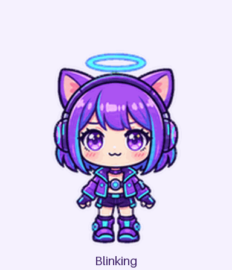

# CyberCat

A cheerful purple cyber cat companion with cyan headphones and a halo, adapted from the [CyberCat brand mascot](https://github.com/zixiCat/CyberCat/tree/master/brand).

## Preview

[Cute highlights](cute.gif) · [All-state video](preview.mp4) · [Motion stills](motion-stills.png)

## Cute animations

| Animation | Preview |
| --- | --- |
| Calm blinking | [idle.gif](animations/idle.gif) |
| Friendly wave | [waving.gif](animations/waving.gif) |
| Playful hop | [jumping.gif](animations/jumping.gif) |
| Hopeful waiting | [waiting.gif](animations/waiting.gif) |
| Running right | [running-right.gif](animations/running-right.gif) |
| Running left | [running-left.gif](animations/running-left.gif) |
| Error reaction | [failed.gif](animations/failed.gif) |
| Focused work | [running.gif](animations/running.gif) |
| Reviewing work | [review.gif](animations/review.gif) |

The desktop sprite sheet also includes sixteen clockwise look directions. See [the contact sheet](contact-sheet.png) and [look loop](look.gif).

## Install

Run `setup/install-config.ps1` with the actual checkout root as `RepositoryPath`. It resolves this computer's Codex home and installs only `pet.json` and `spritesheet.png` into its `pets/cybercat` directory. Existing selection and unrelated pets stay unchanged; changed package files receive local backups. Then open Settings > Pets, select Refresh, and choose CyberCat.

The package uses sprite version 2: a transparent 1536 × 2288 PNG, eight columns and eleven rows, with 192 × 208 cells. The first nine rows contain 6, 8, 8, 4, 5, 8, 6, 6, and 6 animation frames; the last two rows contain sixteen look directions. Unused cells are transparent.

## Validation

The [atlas validation](qa/atlas-validation.json), [quality gate](qa/pet-quality.json), and [three-reviewer blind gaze check](qa/blind-validation.json) passed for the packaged PNG. The hop lifts 42 pixels and lands on the idle baseline. Some shallow diagonal gaze changes are subtle, and the two look-row joins have larger head-orientation changes; the quality report records these reviewed warnings. QA reports describe generation-time checks; intermediate pose strips and extracted frames remain outside this repository.

## Source and generation

The original mascot reference is [source/CyberCat.png](source/CyberCat.png), from CyberCat commit `d85444aec918b33c9418af0953f552e8491bac21`. The full-body interpretation is [cybercat.png](cybercat.png). Built-in ImageGen produced the character and pose strips; deterministic tools extracted frames, assembled the sprite sheet, and encoded the previews. The brief preserves purple bob hair, cyan streaks, violet eyes, cat ears, headphones, halo, and purple cyber clothing, with cute expressive motion and no extra props or text.

These files contain reusable art and metadata only. Local pet selection, account data, sessions, and histories do not belong in this directory.
